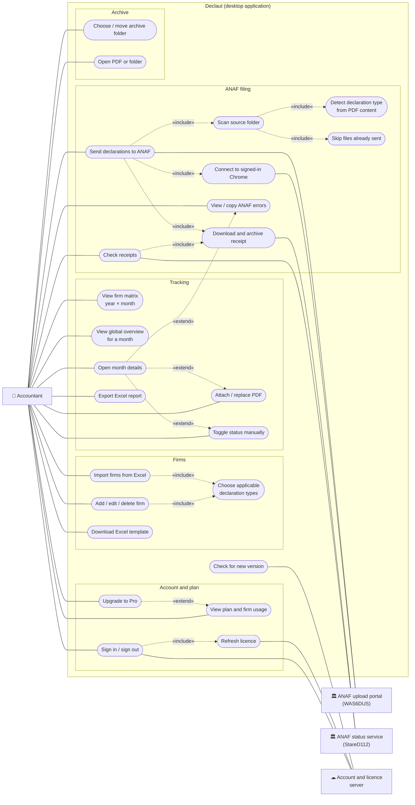
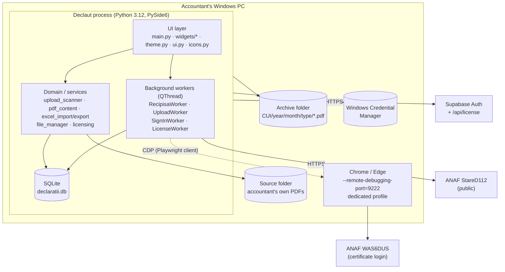
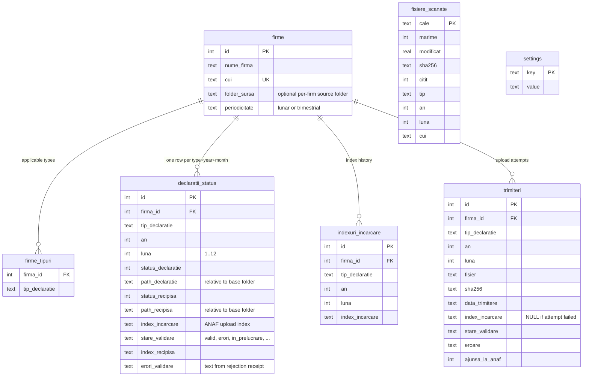
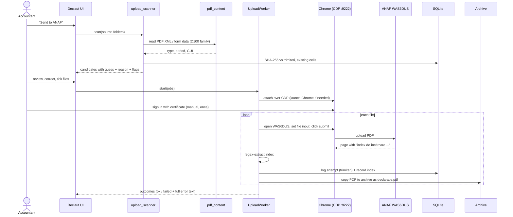
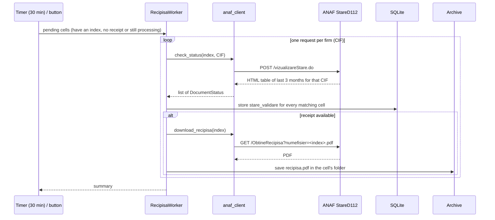
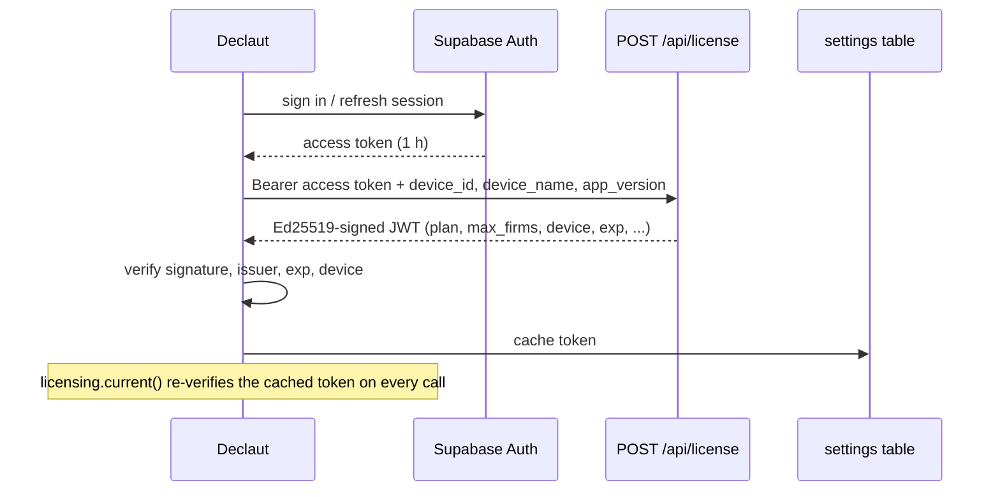
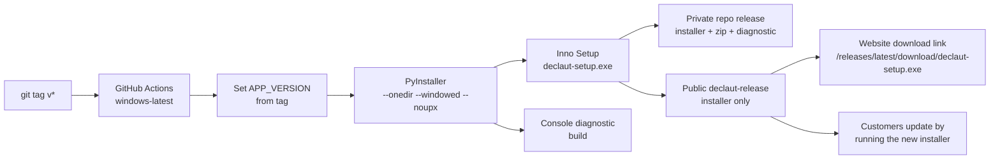

# Declaut — Use Cases and Technical Analysis

Declaut is a Windows desktop application for Romanian accounting firms. It keeps
track of which tax declarations have been filed, for which company and which
month, sends them to ANAF (the Romanian tax authority), collects the receipts
(*recipise*) and archives everything on disk in a predictable structure.

This document describes what the application does (use cases) and how it is
built (architecture, data model, integrations, security, build and release).
It reflects the code at version `0.9.x`.

> **Language note.** The user interface is in Romanian. Database table and
> column names are also Romanian (`firme`, `declaratii_status`, `trimiteri`,
> `luna`, …). Both are kept as they are in the code and explained where they
> appear below.

---

## 1. Problem and scope

An accountant who manages dozens of companies has to file several recurring
declarations per company per month (or quarter), and keep proof that each one
was accepted. Doing this by hand means:

- remembering which of the declarations apply to which company;
- uploading each signed PDF to ANAF's portal one at a time;
- noting down the *upload index* ANAF returns, then returning to download the
  receipt — which ANAF keeps for only **60 days**, and whose status service only
  covers the **last 3 months**;
- filing the PDFs and receipts in some folder structure and finding them again
  at audit time.

Declaut replaces the spreadsheet-and-folders routine with one local tool.

**Declaration types tracked:** `100` (with its rectification `710`), `112`,
`300`, `390`, `394`, `406` and *Case de marcat* (cash registers, form F4109).

**Out of scope:** Declaut does not prepare or sign declarations (the
accountant does that with ANAF's own forms), and it never stores ANAF
credentials or certificates.

**Platform:** Windows is the only supported target. The code also runs on
macOS for development.

---

## 2. Actors

| Actor | Role |
|---|---|
| **Accountant** | The user. Manages firms, files declarations, reviews status. |
| **ANAF upload portal** (`decl.anaf.mfinante.gov.ro/WAS6DUS`) | External. Receives the declaration PDFs. Requires certificate/token authentication. |
| **ANAF status service** (`anaf.ro/StareD112`) | External, public, no login. Reports validation state and serves receipt PDFs. |
| **Account and licence server** | The Declaut website/backend (Supabase Auth + a licence endpoint). Issues signed licence tokens. |
| **GitHub releases** | Hosts the public installer that customers download. The app itself does not call GitHub; it learns the latest version from the licence server's answer. |
| **Chrome / Edge** | The accountant's own browser, driven over the DevTools protocol for uploads. |

---

## 3. Use case diagram

GitHub renders the Mermaid diagram below. Stick figures are not available in
Mermaid flowcharts, so actors are drawn as boxes and use cases as rounded
shapes; `«include»` and `«extend»` follow UML meaning.



*Note:* in the diagram `«include»`/`«extend»` arrows point from the including
(or extending) case to the one it uses, drawn dotted. "Send declarations"
includes receipt handling because a successful upload immediately archives the
file and registers the index, so that the receipt poller can pick the cell up.

### 3.1 Use case descriptions

| ID | Use case | Summary |
|---|---|---|
| UC1 | Sign in / sign out | Email + password against Supabase Auth. Sign-up, email confirmation and password reset happen only on the website. |
| UC2 | View plan and firm usage | The status bar and account dialog show *Free · n/limit firms* or the Pro plan with its paid-until date. |
| UC3 | Upgrade to Pro | Opens the website's pricing page in the browser (payment is handled by the website, not the app). |
| UC4 | Refresh licence | Fetches a fresh signed token; runs on a timer and when the window regains focus. |
| UC5 | Add / edit / delete firm | Name and CUI (tax id, unique). Enforces the plan's firm limit. |
| UC6 | Choose declaration types | Per firm; also VAT periodicity (monthly / quarterly), which drives 300, 394 and 406 together. |
| UC7 / UC8 | Excel import / template | Reads firms from `.xlsx`; the template has the exact recognised columns, dropdowns and an instructions sheet. |
| UC9 | Firm matrix | Years × months grid per declaration type: filed / missing / rectified. |
| UC10 | Global overview | All firms × declaration types for a chosen month; a click jumps to the firm. |
| UC11 | Month details | Declaration and receipt side by side; the initial D100 next to its D710 rectification. |
| UC12 / UC13 | Attach PDF / toggle status | Manual path for declarations filed outside the app. Files are copied into the archive. |
| UC14 | Excel report | Per-month or per-year status report with colour-coded cells. |
| UC15 | Send to ANAF | Select scanned files, review, send in one batch; one failing file does not abort the rest. |
| UC16 | Scan source folder | Walks the accountant's own folder tree and guesses firm, type and period for every PDF. |
| UC17 | Detect type from content | Reads the PDF's embedded XML to tell D100 from D710 (they share a file name). |
| UC18 | Skip already-sent files | SHA-256 of the file is compared with the upload log. |
| UC19 | Connect to signed-in Chrome | Starts the browser with a debugging port; the user signs in with their certificate by hand. |
| UC20 | Check receipts | Queries ANAF's status service for stored upload indices — for one cell or for all pending ones. |
| UC21 | Download and archive receipt | Saves the receipt PDF to the right folder before ANAF's 60-day window closes. |
| UC22 | View / copy errors | Full ANAF error text per attempt and per cell, copyable. |
| UC23 | Archive folder | Chosen on first run; can be moved later together with the existing documents. |
| UC24 | Open PDF / folder | Uses the system's default viewer / file manager. |
| UC25 | Check for new version | The licence response carries `latest_version` and a download link; the app shows a notice when it is newer than the running version. |

---

## 4. Architecture

### 4.1 Overview

Declaut is a single-process desktop application. There is no server of its own
that holds user data: everything the accountant works with lives in a local
SQLite file and a local folder tree. The only network calls are to ANAF and to the
account/licence server (which also reports the latest version).



### 4.2 Technology stack

| Concern | Choice | Why |
|---|---|---|
| Language / runtime | Python 3.12 | Fast iteration; strong PDF and Excel libraries. |
| UI | PySide6 (Qt 6) | Native-feeling desktop UI, light and dark themes, threading primitives. |
| Persistence | SQLite via `sqlite3` | Zero-install, single file, easy to back up. |
| ANAF upload | Playwright used **only as a CDP client** | Attaches to the user's own Chrome; no browser is downloaded or bundled. |
| ANAF status | `urllib` (stdlib) | No extra dependency; two ANAF hosts as fallback. |
| PDF reading | `pypdf` | Pure Python; reads attachments, XFA data and page text. |
| Excel | `openpyxl` | Import, template and report generation. |
| Secrets | `keyring` | Refresh token in Windows Credential Manager. |
| Licence tokens | `PyJWT[crypto]` | Offline verification of Ed25519 (EdDSA) signatures. |
| Packaging | PyInstaller (`--onedir`) + Inno Setup | Folder build avoids Windows Defender false positives that single-file builds trigger. |
| CI/CD | GitHub Actions on `windows-latest` | Tag-driven build and publish. |

### 4.3 Module map

| Module | Responsibility |
|---|---|
| `main.py` | Entry point, main window, sidebar, toolbar, restricted-mode banner, timers, update notice. |
| `config.py` | Constants: declaration types, rectification map, years, paths, environment values, polling intervals, version. |
| `database.py` | Schema, migrations, all SQL, demo data seeding. |
| `file_manager.py` | Archive path rules, PDF import, archive move, open PDF/folder. |
| `anaf_client.py` | HTTP client and HTML parsing for StareD112 (status + receipt download). |
| `anaf_service.py` | `RecipisaWorker`: checks stored indices, stores state, downloads receipts. |
| `anaf_uploader.py` | `UploadWorker`: drives Chrome over CDP to submit PDFs and read the returned index. |
| `upload_scanner.py` | Walks the source folder, guesses firm/type/period, judges "already sent". |
| `pdf_content.py` | Reads declaration type/period/CUI from PDF content; extracts receipt error text. |
| `excel_import.py` / `excel_export.py` | Firm import with template; status report. |
| `auth.py` | Supabase Auth REST client, session handling. |
| `licensing.py` | Device identity, licence token verification, refresh. |
| `account_service.py` | Thin `QThread` wrappers for sign-in and licence refresh. |
| `theme.py`, `ui.py`, `icons.py` | Design system (palette, QSS, drawn icons, shared widgets). |
| `widgets/` | Tabs and dialogs: company tab, overview tab, month, upload, import, report, archive, login, account, upgrade. |
| `installer/declaut.iss` | Inno Setup script. |

### 4.4 Threading model

Network and file-heavy work never runs on the UI thread. Each long operation is
a `QThread` subclass that reports back with Qt signals:

| Worker | Work | Result |
|---|---|---|
| `RecipisaWorker` | One ANAF query per firm (CIF), state update, receipt download | `completed(list[CellOutcome])` |
| `UploadWorker` | Attach to Chrome, submit each PDF, record index, archive file | `progress(str)`, `completed(list[UploadOutcome])` |
| `SignInWorker` | Sign in against Supabase | success / error text |
| `LicenseWorker` | Licence refresh | `RefreshResult` |

The source-folder scan also runs in the background and is cancellable
(`ScanCancelled`), so a large folder tree does not freeze the upload dialog.
Workers write to SQLite through their own short-lived connections.

---

## 5. Data model

All state is in `declaratii.db`. The location is next to the code during
development and `%APPDATA%\DeclaratiiFirme\` in the installed app.



`declaratii_status` has a `UNIQUE (firma_id, tip_declaratie, an, luna)`
constraint: one cell of the year × month matrix is one row. `fisiere_scanate`
and `settings` are standalone.

### 5.1 Design decisions in the schema

- **Relative paths.** Stored document paths are relative to the configurable
  base folder, so the whole archive can be moved or synced without breaking the
  database.
- **Index history.** A resend replaces `index_incarcare`, but ANAF rejects the
  duplicate while the earlier submission stays the valid one. `indexuri_incarcare`
  keeps every index so the receipt check can still find the valid one.
- **Upload log.** `trimiteri` records every attempt, including failures, with
  the file's SHA-256. This is what stops the same file being offered for
  sending twice, and where the full error text lives. `ajunsa_la_anaf` marks
  attempts that failed *after* the file was handed to ANAF, because ANAF may
  have it even though no index came back.
- **Scan cache.** `fisiere_scanate` stores what the scanner learned about a
  file, reused while size and modification time are unchanged — hashing and
  opening every PDF on each scan would make the upload dialog slow.
- **Rectification as a cell.** `710` is stored as its own row, but the UI
  shows it inside its declaration's `100` cell (see 6.4).
- **Migrations.** `init_db` is idempotent: `CREATE TABLE IF NOT EXISTS` plus
  small `ALTER TABLE` / backfill steps for databases created by older versions.

### 5.2 Archive layout on disk

```
<base folder>/<CUI>/<year>/<month>/<type>/declaratie.pdf
                                         /recipisa.pdf
```

Example: `Declaratii_Firme/RO12345678/2026/03/100/declaratie.pdf`.
The base folder is chosen on first run and can be changed later; when it is,
the app offers to move the existing documents along. The archive may not be
inside the source folder, because the source folder is scanned recursively.

---

## 6. Key flows

### 6.1 Sending declarations to ANAF

ANAF's upload page authenticates with a hardware certificate that cannot be
used headlessly. So Declaut **never handles ANAF credentials**. The accountant
signs in by hand in a normal Chrome window; Declaut then attaches to it.



Safety properties of this flow:

- **Nothing is sent on a filename match alone.** Every field the scanner fills
  in is a guess with a reason, shown for review. Uploads to ANAF cannot be
  undone.
- **Duplicates are blocked by content, not name.** A file with the same bytes
  as a previous validated or in-progress submission is hidden. A rejected one,
  or a new file for a period that already has a valid or pending submission,
  appears unticked with the reason in the notes column.
- **Signed vs unsigned.** Accountants keep both copies side by side; unsigned
  duplicates are flagged so only the signed one is filed.
- **Failure isolation.** One bad file does not abort the batch.
- **Ambiguous failures are recorded honestly.** If the click timed out or the
  page didn't return an index, the attempt is logged as *reached ANAF* and the
  message tells the user to check in Chrome before resending.
- **Page-layout resilience.** The submit control is looked up with several
  selectors; on failure the error includes a snippet of the page text so a
  change in ANAF's layout can be diagnosed from the log.

### 6.2 Receipt checking



Details:

- **One call covers many cells.** ANAF answers with every submission for the
  CIF in the last three months, so a single query refreshes all stored
  declarations of that firm.
- **Normalised states:** `valid`, `erori` (validation errors), `in_prelucrare`
  (processing), `invalid`, `necunoscut`, and the app-only `negasit` (the stored
  index is not in ANAF's answer: wrong index, wrong CIF, or older than three
  months). Network failures are deliberately *not* a state, so a flaky
  connection never repaints the table.
- **Rejected declarations.** The receipt of a rejected declaration is ANAF's
  list of errors. Its text is extracted and stored so the user can read and
  copy it from the month dialog.
- **Host fallback.** ANAF serves the same application from two hosts
  (`www.anaf.ro`, `stare.anaf.ro`); every request falls back to the mirror
  when the main host is down.
- **Time pressure.** ANAF keeps receipts 60 days and the status service shows
  three months. Automatic polling and immediate archiving exist for that reason.

### 6.3 Reading what a PDF is (`pdf_content`)

ANAF's smart PDFs carry each declaration twice: as the form the accountant
fills in, and as the XML that the form's validation button attaches
(`D100.xml`, `D710.xml`). The XML is what ANAF actually processes, so it is the
most reliable source. Detection tries, in order:

1. the attached XML — the root element names the declaration
   (`<declaratie100>`, `<declaratie710>`), its attributes give period and CUI;
2. the XFA form data (`<formType>`);
3. the page text stamp (for example `D710_A300`).

If all fail the function returns nothing, never raises, and the scanner falls
back to the file path and name. Files above a size limit are not opened, so a
stray archive in the source folder cannot stall a scan.

### 6.4 D100 and its rectification D710

ANAF's D100 smart PDF has a D100 / D710 switch, so a single file name
(`D100_710_XML_<MM>_<YYYY>_[rec_]<CUI>.pdf`) covers both. In the data model
`710` is a separate row, but in the UI it has no button or column of its own:

- the overview cell shows *Rectificată*;
- the firm matrix marks the month with ✎;
- the month dialog shows the initial D100 and the D710 side by side, each with
  its own receipt, index and state.

Every firm that files `100` is assumed able to file `710` (`config.RECTIFICATIVE`).

### 6.5 Excel import

`parse_excel` locates columns by normalised header text (accent- and
case-insensitive), accepts a tick (`x`) per declaration column and a VAT
periodicity column, normalises CUIs, and returns a `ParseResult` with per-row
problems for the dialog to show before `import_firms` writes anything. The
generated template contains exactly the recognised headers, dropdowns for
ticks and periodicity, and an instruction sheet.

---

## 7. Accounts, licensing and plans

### 7.1 Plans

| | Free | Pro |
|---|---|---|
| Features | All | All |
| Firms | Limited (`FREE_MAX_FIRMS` in `config.py`) | Unlimited |
| Devices | — | 2 |

When a licence is missing, invalid, expired, or the user is signed out or
offline past expiry, the app uses the Free plan.

### 7.2 Restricted mode

If the firm count exceeds the plan's limit (typically a lapsed Pro
subscription), the app enters **restricted mode**: adding and importing firms,
uploading to ANAF and receipt checks are disabled, and a banner explains why
and how to resolve it. **All recorded data stays viewable, editable and
exportable.** Upgrading or deleting firms down to the limit lifts it
immediately. The principle: a billing problem must never lock a user out of
their own records.

### 7.3 Sign-in

- Email and password are exchanged for a session through Supabase Auth's REST
  API using plain `urllib` — no SDK is bundled.
- The **refresh token** is stored in the Windows Credential Manager through
  `keyring`, never in the SQLite file. The **access token** lives in memory
  only and is renewed shortly before it expires.
- Sign-up, email confirmation and password reset happen only on the website.

### 7.4 Licence tokens



- **Offline verification.** The token is verified on every call to
  `licensing.current()` against a public key compiled into the app, so an
  expired token turns into Free without waiting for a refresh, and the app
  works offline until the token's own expiry.
- **Required claims:** `exp`, `iss` (`declaut`), `plan`, `device`. `iat` is
  deliberately not checked so a PC whose clock runs a few minutes behind does
  not reject a token fresh from the server.
- **Device binding.** `device_id` is a SHA-256 of the Windows `MachineGuid`
  (prefixed `declaut:`), so the server never sees the raw value and the id
  survives reinstalls. When the registry value cannot be read (for example on a
  development Mac) a random UUID stored in the database is used instead.
- **A bad token never replaces a good one.** If a refresh returns a token this
  build cannot verify, the cached one is kept.
- **Refresh schedule:** every 6 hours, and when the window regains focus (for
  example after paying in the browser), at most once per minute.
- **The app holds only public values.** The licence key can check tokens but
  never issue them; payment-provider secrets and the licence private key live
  only on the server.

### 7.5 Environments

`config.py` defines `production` and `staging` sets of server values. A
frozen (installed) build always uses production; `DECLAUT_ENV=staging` is
honoured only when running from source, so a shipped executable cannot be
redirected to another server.

A build whose version ends in `-pro` runs with the Pro plan unlocked, without
a token or sign-in (used for internal distribution).

---

## 8. User interface

- **Structure.** A sidebar for navigation only, a header toolbar for actions,
  two main tabs (per-firm matrix; global overview), and dialogs for the month,
  upload, import, report, archive folder, account and login.
- **Design system.** `theme.py` holds the palette and builds the Qt stylesheet
  for light and dark appearances, following the system setting; `icons.py`
  draws line icons in code; `ui.py` holds shared building blocks. Widgets use
  semantic properties (`role`, `variant`, `status`) rather than hard-coded
  colours.
- **Accessibility.** Status is never conveyed by colour alone (a mark and a
  word accompany it); text contrast of at least 4.5:1 is enforced in both
  appearances.
- **Excel report colours** are fixed constants, independent of the UI theme.
- **Responsiveness.** Slow operations run in workers with progress text; the
  window opens on the cached licence immediately, even offline, and asks the
  server afterwards.

---

## 9. Security and privacy

| Topic | Approach |
|---|---|
| ANAF credentials | **Never handled.** The user authenticates in their own Chrome with their certificate. Declaut attaches to the already-authenticated tab. |
| Browser profile | A dedicated Chrome profile is used because recent Chrome refuses remote debugging on the default profile. The profile persists, so the ANAF session survives a restart. |
| Debugging port | Fixed at `9222` on the local machine so a relaunch reuses the same channel. |
| Account session | Refresh token in Windows Credential Manager; access token in memory only. |
| Licence integrity | Ed25519 signature, issuer, expiry and device checked on every read. Editing the cached token gains nothing; any failure falls back to Free rather than locking out. |
| Embedded secrets | Only public values are compiled in (publishable key, licence *public* key, website URL). |
| User data | Stays on the PC: SQLite file and the archive folder. No declaration content is sent to Declaut's servers. Only the account email, a hashed device id, the device name and the app version go to the licence endpoint. |
| Destructive actions | Uploads are always reviewed before sending; ambiguous failures are reported as "may have reached ANAF" rather than silently retried. |
| Updates | The app announces a newer version; it does not download or execute updates on its own. |

---

## 10. Build, packaging and release



- **Version from the tag.** The workflow rewrites `APP_VERSION` in `config.py`
  before building, so tag, running app and installer version always agree.
- **`--onedir`, not `--onefile`.** A single-file executable self-extracts to
  `%TEMP%` at startup, which Windows Defender's heuristics regularly flag as a
  trojan. `--noupx` avoids a second common trigger.
- **Installer.** Inno Setup gives Start-menu and desktop shortcuts, removal
  from *Apps & features*, and in-place upgrades (a fixed `AppId` makes a newer
  installer an upgrade of the installed one). It supports a per-user install
  without administrator rights. Old support files are cleared on upgrade. User
  data (database in `%APPDATA%\DeclaratiiFirme`, sign-in in Credential Manager)
  is untouched by updates and uninstalls.
- **Diagnostic build.** A console variant is built alongside so a startup
  exception prints a traceback instead of failing silently (a windowed build has
  nowhere to write it).
- **Two release targets.** The private repo receives all build files for the
  team; the public `declaut-release` repo receives only the installer. A tag
  with a hyphen (for example `v0.9.0-rc1`) is published as a **pre-release**, so
  the "latest" download link ignores it (and, per the project README, so does the update notice, which is based on the latest tag of the public repo) — this is how a
  build is tested without reaching customers.
- **CI hygiene.** Old artifacts are pruned before upload to stay within the
  private repo's storage quota.

---

## 11. Quality attributes

| Attribute | How it is addressed |
|---|---|
| **Data safety** | Local-only data; relative paths so the archive can move; migrations are additive; archive move offers to carry documents along. |
| **Availability of records** | Restricted mode never blocks viewing, editing or exporting. Licence failures degrade to Free. |
| **Resilience to ANAF** | Mirror host fallback; tolerant HTML parsing; page text kept with errors; timeouts set explicitly (15 s CDP attach, 120 s submit wait, 30 s status). |
| **Responsiveness** | All network/file-heavy work in `QThread` workers; scan cache keyed by size + mtime; startup does not wait for the network. |
| **Correctness of filing** | Content-based type detection; SHA-256 duplicate detection; human review before every send; partial-failure tolerant batches. |
| **Maintainability** | Flat, small modules with one responsibility each; domain logic (`upload_scanner`, `pdf_content`, `excel_import`) independent of widgets; plain standard-library HTTP where possible. |
| **Portability** | Windows target; macOS supported for development (paths, Chrome candidates and a Qt plugin cache workaround are handled per platform). |

---

## 12. Known limitations and open points

- **Dependence on ANAF's page layout.** Upload automation reads the WAS6DUS
  page (file input, submit button, index text). A layout change can break it;
  errors include page text to make that diagnosable.
- **Chrome is required** for uploads (Edge is also tried). The user must sign
  in with their certificate once per session.
- **ANAF windows.** Receipts are only available for 60 days and status for
  three months; a declaration not checked in time keeps its stored state but
  can no longer be refreshed (`negasit`).
- **Single user, single database.** There is no multi-user sync; moving to a
  new PC means moving the database and the archive folder.
- **Windows-only is verified for distribution.** Fonts, toolbar width at small
  window sizes and dark mode following the Windows setting have not been
  checked on every Windows version.
- **Future months** currently appear as *missing*; a neutral "pending" state
  is a product decision still open.
- **Automated tests.** The repository has no automated test suite; PDF
  reading was verified manually against real ANAF samples (initial D100, its
  D710, and a rejection receipt).

---

## 13. Glossary

| Term | Meaning |
|---|---|
| **ANAF** | Agenția Națională de Administrare Fiscală — Romanian tax authority. |
| **CUI / CIF** | Company tax identification number. |
| **Declarație** | Tax declaration (D100, D112, D300, …). |
| **Rectificativă** | Corrective declaration (D710 corrects D100). |
| **Recipisă** | Signed receipt ANAF issues for a submission; for a rejected one, it lists the errors. |
| **Index de încărcare** | Upload index ANAF returns after a file is submitted; the key for status and receipt lookups. |
| **WAS6DUS** | ANAF's certificate-authenticated declaration upload page. |
| **StareD112** | ANAF's public service for checking the state of a submission. |
| **CDP** | Chrome DevTools Protocol, used to drive the user's own browser. |
| **Smart PDF** | ANAF's fillable PDF forms that attach a validated XML. |
